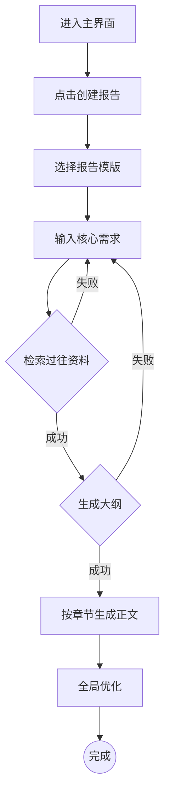

# PRD 各模块生成规范

## 模块总览

根据需求规模，选择需要生成的模块：

| 模块 | 小需求 | 中等需求 | 完整产品 |
|------|--------|---------|---------|
| 一、基础信息 | 可选 | ✅ | ✅ |
| 二、背景与目标 | ✅（精简版） | ✅ | ✅ |
| 三、用户画像 | ✅（精简版） | ✅ | ✅ |
| 四、功能规划 | ✅ | ✅ | ✅ |
| 五、流程设计 | ✅ | ✅ | ✅ |
| 六、详细功能需求 | ✅（核心功能） | ✅ | ✅ |
| 七、Agent/Prompt 设计 | 按需 | 按需 | ✅ |
| 八、评估体系 | 跳过 | ✅ | ✅ |
| 九、非功能需求 | 跳过 | ✅（精简） | ✅ |
| 十、兜底策略 | ✅ | ✅ | ✅ |
| 十一、埋点设计 | 跳过 | ✅ | ✅ |
| 十二、角色权限 | 跳过 | 按需 | ✅ |

---

## 模块一：基础信息

**目的**：让任何人拿到文档都能快速了解版本状态。

**必含字段**：
- 产品版本号
- 创建时间、创建人
- 变更日志（时间、版本、变更人、变更内容）
- 名词解释（项目专有术语定义表）

**质量标准**：表格形式，不超过 1 页。名词解释必须覆盖所有 AI 相关术语（如 RAG、Agent、Embedding、LLM 等）和业务领域专有名词。

---

## 模块二：背景与目标

**核心原则**：这是整份 PRD 最重要的部分。必须让读者在 30 秒内理解：问题是什么、为什么重要、为什么现在就重要。

### 需求背景
**写法要求**：
- 用一段话讲清楚核心矛盾（谁遇到了什么问题，现状多痛，机会多大）
- 用「现状→痛点→机会点」三列表格做结构化展示
- 维度覆盖：业务、数据、专家知识、质量风险（根据实际情况调整）

**反面示例**：不要写"随着 AI 技术的发展..."这种空话，必须有具体的数据和场景。

### 项目目标
**写法要求**：
- 北极星指标：唯一、最关键的指标，衡量核心用户价值
- 商业指标：产品希望达成的商业效果（如营收提升、成本降低）
- 业务指标：产品希望为用户实现什么价值（如效率提升、工时缩短）
- 技术指标：评估模型本身性能（如准确率、事实性错误率）

**质量标准**：每个指标必须可量化、有明确的度量方式和数据来源。不能出现"提升用户体验"这种无法衡量的目标。

---

## 模块三：用户画像

**核心原则**：不是填模板，是真正理解用户。

**写法要求**：
- 为每类核心用户创建画像卡片，包含：角色名称、专业背景、核心任务、痛点、诉求
- 描述真实的使用场景，而非抽象概括
- 若有条件，附上原始用户流程图（用户在没有这个产品时是怎么完成工作的）

**质量标准**：
- 用户的痛点必须和"需求背景"中的问题对应
- 用户的诉求必须和"项目目标"中的指标对应
- 如果用户未提供画像信息，标注跳过，不要编造

### 竞品分析（可选）
如果用户提供了竞品信息：
- 竞品名称、对标功能点、借鉴要点
- 差异化定位：用一句话说清楚"我们和竞品的核心差异"
- 重点是"我们可以借鉴什么"而非"竞品有什么"

---

## 模块四：功能规划

**核心原则**：一张表讲清楚做什么、不做什么、先做什么。

**写法要求**：
- 用表格形式列出所有功能点
- 每个功能点一句话描述验收标准
- 标注优先级（P0→P3）
- 标注里程碑和预期完成日期（如用户提供了排期信息）

**优先级框架**（二选一，根据团队习惯选择）：

方式 A — P0-P3：
- P0：用户价值高，实现成本低——必做
- P1：用户价值高，实现成本高——重点做
- P2：用户价值低，实现成本低——顺手做
- P3：用户价值低，实现成本高——先不做

方式 B — MoSCoW：

| 级别 | 含义 | 说明 |
|------|------|------|
| **Must Have** | 本期必须上线 | 不上线产品就没价值 |
| **Should Have** | 本期应该上线 | 有明显价值但可延期 |
| **Could Have** | 有时间就做 | 锦上添花 |
| **Won't Have** | 本期明确不做 | 写清楚范围外，防止需求蔓延 |

使用 MoSCoW 时，需求用 User Story 格式书写：
> 作为【角色】，在【场景】中，为了【目标】，我需要【功能】，验收标准为【可测试的条件】

---

## 模块五：流程设计

**核心原则**：用图说话，文字辅助。

**必须包含的图**：
1. **用户操作流程图**：用户的完整路径（从进入到完成）
2. **核心交互逻辑图**：用户与系统的关键交互节点
3. **系统处理流程**：后端 AI 处理链路（尤其是 Agent 调用链）

**图表规范**：
- 给开发看：必须使用 Mermaid 代码块
- 给 AI 看：使用 Mermaid 代码块
- 给业务方：可用文字描述，附 Mermaid 作补充

**Mermaid 流程图示例**：


---

## 模块六：详细功能需求

**核心原则**：让开发人员看完就能动手，不需要再来问产品。

**每个功能必须包含**：
- **入口**：用户从哪里触发这个功能
- **交互**：用户的操作步骤和系统的响应
- **反馈**：系统在各种状态下给用户的反馈（加载中、成功、失败）
- **异常处理**：格式不支持、文件过大、网络中断、解析失败等

**按产品类型侧重**：
- 工具型：重点描述每个页面/组件的交互细节
- Agent 型：重点描述 Agent 的输入输出和调用逻辑
- 对话型：重点描述对话流、意图识别、多轮管理

---

## 模块七：Agent/Prompt 设计

**⚠️ 特殊处理**：此模块不可直接生成，必须先引导用户提供业务逻辑后再写。

→ Agent 设计详见 `agent-design-spec.md`
→ Prompt 设计详见 `prompt-design-spec.md`

### Agent 设计模板

每个 Agent 使用 Agent Story 格式定义：

```markdown
### [Agent 名称]

**Agent Story**：
As [Agent 角色],
Given [输入上下文 + 可用工具],
When [触发条件],
Then [期望输出 + 质量标准],
Fallback [失败时的降级行为],
Boundary [此 Agent 不做什么]

**Role**：[身份定义和专业能力]
**Inputs**：[所有需要的上下文变量，使用 {{变量名}} 标记]
**Action Path**：[按序号列出执行步骤]
**Tool Use Rules**：[每个工具的入参、调用时机、目的]
**Output Specifications**：[输出格式和要求]
**Constraints**：[不可违反的规则]
```

### 槽位设计（对话型产品必须定义）

适用于需要收集多个参数的对话场景（如智能客服、表单填写 Agent）：

| 槽位名 | 必填/选填 | 数据类型 | 提取方式 | 追问话术 | 验证规则 |
|--------|---------|---------|---------|---------|---------|
| `{slot_name}` | 必填 | string / enum / date | LLM 提取 / 规则提取 | [标准追问话术] | [验证条件] |

### 外部系统集成表

AI 产品通常需要调用外部系统，用以下表格明确集成规范：

| 系统名称 | 集成类型 | 用途 | 认证方式 | 频率限制 | 降级策略 |
|---------|---------|------|---------|---------|---------|
| [系统名] | REST API / SDK | [用途说明] | API Key / OAuth | [QPS 限制] | [降级方案] |

### 全局上下文管理（多 Agent 协作时必须定义）

```json
{
  "doc_config": {
    "title": "项目标题",
    "domain": "所属领域",
    "doc_type": "文档类型"
  },
  "global_facts": {
    "key_metrics": {},
    "project_scope": ""
  },
  "writing_memory": {
    "chapter_summaries": [],
    "global_terminology": [],
    "last_chunk_ending": ""
  },
  "runtime_data": {
    "current_rag_results": "",
    "user_requirements": ""
  }
}
```

---

## 模块八：评估体系

**核心原则**：AI 产品上线前必须有评估标准和测试集，否则无法判断效果。

→ 完整的 4 层评估框架 + Benchmark 设计方法论详见 `evaluation-framework.md`

**写法要求**：
- 按 L1-L4 四层定义评估指标和目标值
- 构建 ≥10 条 Benchmark 测试集（覆盖正常/边界/异常）
- 定义 Badcase 闭环流程

**质量标准**：评估集必须由业务专家和产品/算法团队协作完成，不能只有技术人员自定义。

---

## 模块九：非功能需求

**写法要求**：用表格列出，覆盖以下维度：

| 维度 | 典型指标 |
|------|---------|
| 性能 | 响应时间（TTFB / 完整响应）、并发量、加载时间 |
| 准确性 | 意图识别准确率、信息提取召回率/精准率 |
| 可用性 | 系统可用率（≥ 99.9%）、容错性、数据完整性 |
| 安全性 | 认证、授权、数据加密、审计日志、内容安全 |
| 易用性 | 学习成本、操作效率、可访问性 |
| 兼容性 | 浏览器、文件格式、设备 |

### 可观测性（AI 产品必须单独列出）

多 Agent 系统的调试复杂度是指数级的，可观测性是生命线。

| 维度 | 需定义的内容 |
|------|------------|
| **日志记录** | 记录范围（用户输入、模型输出、工具调用链路、token 用量）、日志级别、保留时长 |
| **指标监控** | 关键指标实时监控（响应时间、错误率、幻觉率）、告警阈值和通知渠道 |
| **错误追踪** | 错误分类（模型超时/工具调用失败/格式异常）、严重错误的处理流程和 SLA |
| **链路追踪** | Agent 决策链路的可追溯性（每个 Agent 的输入输出、调用时序、耗时） |

---

## 模块十：兜底策略

**核心原则**：AI 产品 PRD 必须包含此模块，没有兜底的 AI 产品不能上线。

**写法要求**：用表格列出，每行包含：
- 触发条件：什么情况下触发兜底
- 系统行为：系统如何处理
- 用户感知：用户看到什么提示

**常见兜底场景**：
- 检索/召回质量低（置信度低于阈值）
- 文档上传/解析失败
- AI 服务超时/失败
- 网络中断
- 用户输入超出能力边界
- 敏感/有害内容检测

---

## 模块十一：埋点设计

**核心原则**：构建用户行为漏斗，度量核心功能使用率，监控产品性能。

**写法要求**：
- 按用户旅程阶段组织（创建→生成→交互→产出）
- 每个埋点包含：埋点 ID、事件名称、事件描述、触发条件
- AI 产品额外埋点：模型调用次数、平均响应时间、兜底触发次数、用户采纳率

---

## 模块十二：角色权限

**写法要求**：
- 用矩阵表格展示：行 = 功能点，列 = 角色
- 用 ✅/❌ 标记各角色的权限
- AI 产品额外考虑：谁可以修改 Prompt、谁可以查看评估数据、谁可以标注训练数据
